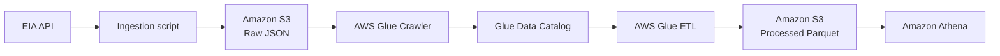
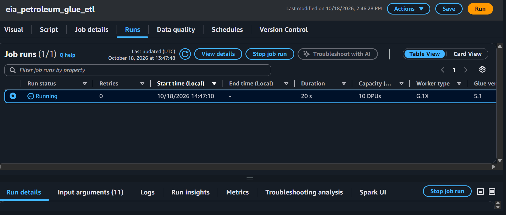
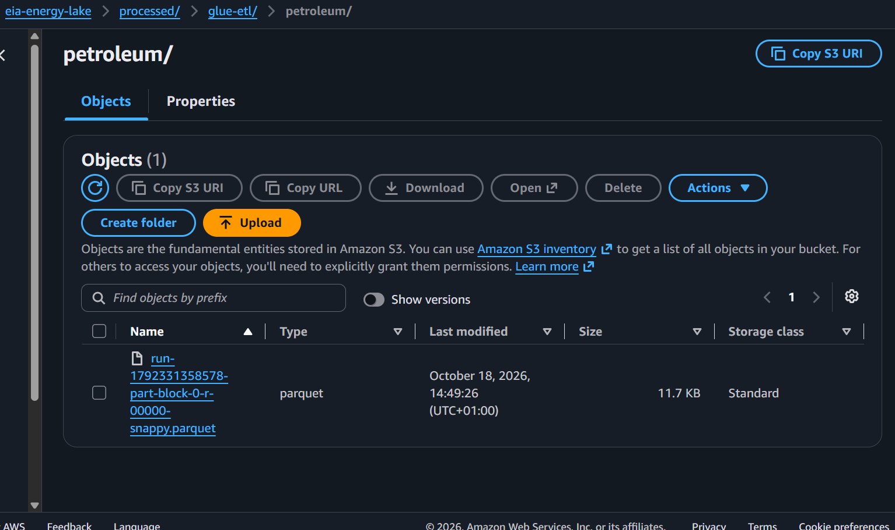
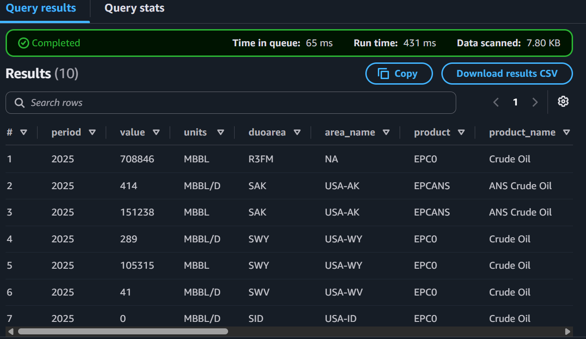

# EIA Petroleum Data Lake

A batch data lake for U.S. petroleum data from the [U.S. Energy Information Administration (EIA)](https://www.eia.gov/). The pipeline stores the API response in Amazon S3, transforms nested records with AWS Glue, and makes the data available for SQL analysis in Amazon Athena.

## Architecture

The ingestion script is [`src/eia_api_to_s3.py`](src/eia_api_to_s3.py). It requests annual petroleum data and writes the unmodified API response to S3 using year, month, and day partitions. A Glue crawler catalogs the raw data. The Glue ETL job flattens the nested records, converts values to numeric types, and writes the processed dataset in Parquet format with Snappy compression.

## Data layout

| Layer | S3 location | Format |
|---|---|---|
| Raw | `s3://eia-energy-lake/raw/eia/petroleum/year=YYYY/month=MM/day=DD/` | JSON |
| Processed | `s3://eia-energy-lake/processed/glue-etl/petroleum/` | Parquet with Snappy |
| Athena results | `s3://eia-energy-lake/athena-results/` | Query results |

The Glue Data Catalog database is `eia_energy_catalog`; the raw table is `petroleum`. The processed data was validated with Athena, including a record-count check.

## Results

- The Glue ETL job completed successfully.
- The processed dataset contains **1,344 records**.
- Athena queries returned flattened petroleum records for analysis.

### Pipeline evidence

<table>
  <tr>
    <td align="center"> Successful Glue ETL run</td>
    <td align="center"> Parquet output in S3</td>
    <td align="center"> Records queried in Athena</td>
  </tr>
</table>

## Technologies

- EIA API
- Python for API ingestion
- Amazon S3
- AWS Glue Crawler and Data Catalog
- AWS Glue ETL
- Amazon Athena
- JSON, Parquet, and Snappy compression

## Configuration

The ingestion script reads `EIA_API_KEY`, `S3_BUCKET_NAME`, and `AWS_DEFAULT_REGION` from the environment. AWS credentials are supplied separately through an AWS CLI profile. Use an IAM policy scoped to the project bucket, and do not commit API keys or AWS credentials.

The project was configured for the `eu-north-1` (Europe/Stockholm) region.

## Scope

This repository documents the implemented batch data-lake pipeline. Kafka/Amazon MSK was considered as a streaming extension but was not deployed.
